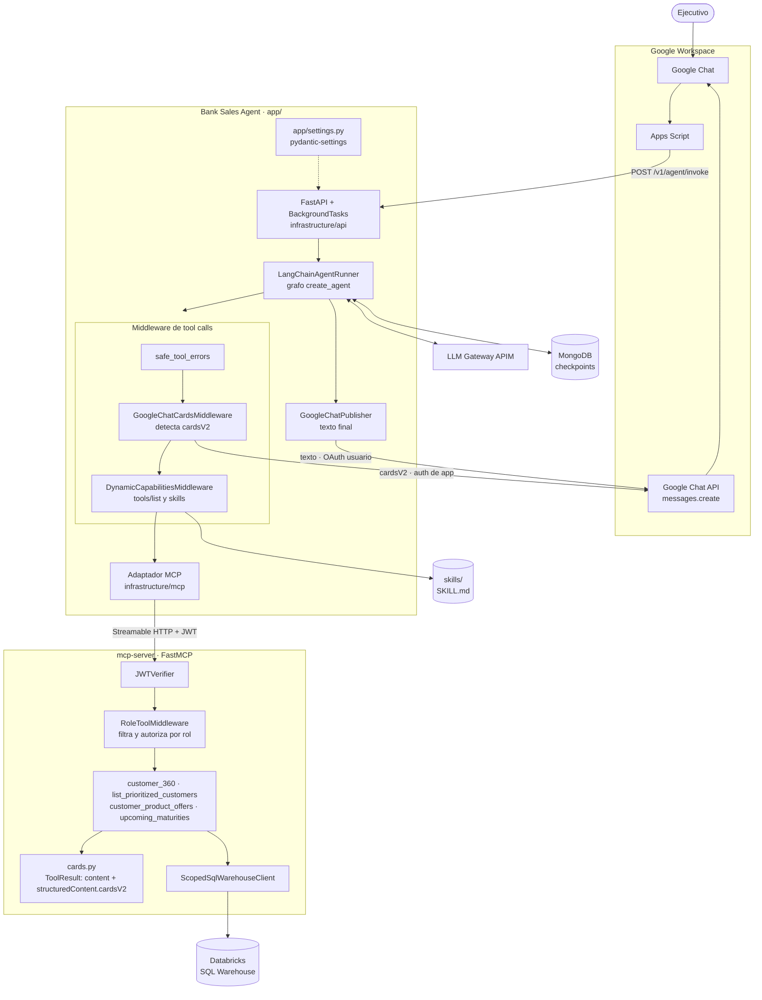
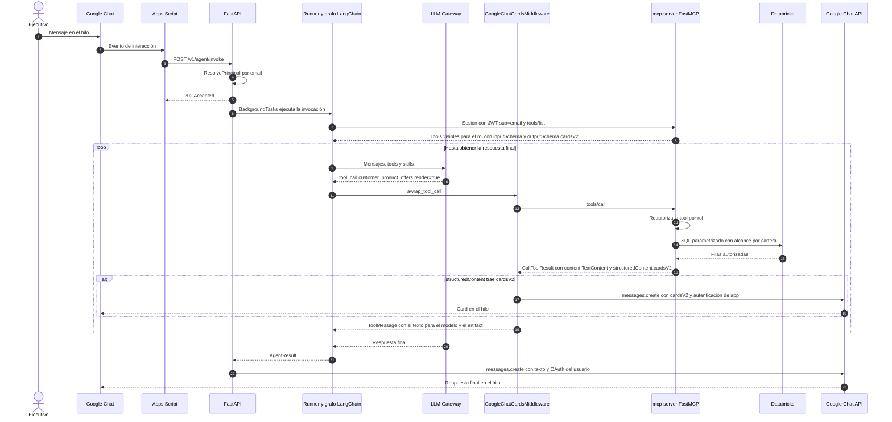

# Bank Sales Agent

Mockup ejecutable de un agente para ejecutivos bancarios, construido con FastAPI, LangChain
`create_agent`, FastMCP y Clean Architecture. Incluye Vista 360, listado priorizado, ofertas
preaprobadas, vencimientos, roles, alcance por cartera, jerarquía de líderes, cards de Google Chat y
un adaptador Databricks.

Apps Script normaliza los eventos de Google Chat y llama a FastAPI, que responde inmediatamente.
El agente se ejecuta mediante `BackgroundTasks`. Cuando una tool MCP devuelve `cardsV2` en su
`structuredContent`, un middleware las publica en el hilo apenas termina la tool; al final se
publica el texto de la respuesta. El modo local usa clientes mock; `GOOGLE_CHAT__ENABLED=true`
activa ADC/Workload Identity.

## Arquitectura



### Secuencia de una solicitud con card



El modelo sólo recibe el `content` textual de cada tool. Las `cardsV2` viajan en
`structuredContent`, quedan como `ToolMessage.artifact` y nunca se agregan a los mensajes del LLM.

## Estructura

```text
app/
├── settings.py             # pydantic-settings: único punto de lectura del environment
├── domain/                 # entidades, roles, capacidades y reglas puras
├── application/
│   ├── agent/              # instrucciones conversacionales
│   ├── ports.py            # contratos requeridos por el negocio
│   └── use_cases/          # sólo orquestación de negocio real, no wrappers de queries
└── infrastructure/
    ├── agent/              # runtime, middleware del grafo y registry de tools MCP
    ├── api/                # factory, rutas, schemas y composition root en lifespan
    ├── google_chat/        # cliente, publisher y middleware que publica cardsV2
    ├── mcp/                # cliente HTTP y adaptadores de tools externas
    ├── skills/             # provider SKILL.md y lectura progresiva de recursos
    └── mock/               # datos locales reemplazables
```

Los imports usan el paquete `app`, por ejemplo `from app.infrastructure.mcp.client import
McpToolGateway` y `from app.settings import Settings`.

`mcp-server/` contiene el servicio FastMCP desplegable de forma independiente; también construye
las cards (`bank_sales_mcp/cards.py`). `packages/bank-sales-contracts/` contiene identidad y modelos
compartidos. Las capacidades, permisos y catálogo autorizado pertenecen exclusivamente al MCP.

La explicación general está en [docs/architecture.md](docs/architecture.md). La discusión y decisión
sobre la relación tool-query quedó registrada en
[ADR 0001](docs/adr/0001-tool-query-runtime-context.md); el transporte MCP se describe en
[ADR 0002](docs/adr/0002-mcp-role-profiles.md). Las prácticas recomendadas y su orden de
adopción están en [Engineering Practices Roadmap](docs/engineering-practices-roadmap.md).

## Ejecutar

```bash
cp .env.example .env
uv sync --group dev
uv run uvicorn app.main:app --reload
```

## Desarrollo

### Herramientas actuales

- `uv`: dependencias reproducibles y lockfile.
- Ruff: lint, imports, modernización y formato automático.
- MyPy strict: validación estática de tipos.
- Pytest y `pytest-asyncio`: pruebas unitarias y asíncronas.
- `pytest-cov`: branch coverage con un mínimo inicial de 73%.
- `pre-commit`: Ruff lint con autofix y formatter antes de cada commit.
- `pydantic-settings`: configuración tipada y secretos redactados.

```bash
# Instala los hooks locales una vez
make pre-commit-install

# Corrige lint y formato
make format

# Ejecuta lint, format check, MyPy, tests y coverage
make check
```

Pytest mide branch coverage sobre `app` y exige un mínimo inicial de 73%. Pre-commit
ejecuta solamente los checks rápidos y autocorregibles de Ruff; la validación completa queda en
`make check` y debe ejecutarse también en CI.

La instancia mock usa un modelo real y requiere `LLM_GATEWAY__API_KEY`. Una prueba REST:

```bash
curl -X POST http://127.0.0.1:8000/v1/agent/invoke \
  -H 'content-type: application/json' \
  -d '{
    "message":"Dame mi lista de clientes prioritarios",
    "space_name":"spaces/AAAA",
    "thread_name":"spaces/AAAA/threads/BBBB",
    "user_email":"ejecutivo@bank.test",
    "user_oauth_token":"oauth-token-del-usuario",
    "attachments":[]
  }'
```

La API responde `202 Accepted`; el procesamiento continúa en `BackgroundTasks` y la respuesta se
publica en `space_name/thread_name`. El token OAuth del usuario viaja en `ChatThread` dentro del
contexto de invocación (no en el checkpoint ni en los mensajes de LangChain) y sólo se usa para
publicar el texto final.

Cada tool de datos expone `render: bool = false`. El resultado siempre vuelve al modelo como
contexto; sólo se incluyen `cardsV2` cuando el agente invoca la tool con `render=true`, y en ese caso
la card aparece en el hilo antes que la respuesta final.

## Roles y perfilamiento de tools

| Rol | Valor canónico | Vista 360 | Priorizados | Vencimientos | Ofertas | Alcance |
| --- | --- | --- | --- | --- | --- | --- |
| Ejecutivo comercial | `commercial` | Sí | Sí | Sí | Sí | Cartera propia |
| Ejecutivo inversiones asesor | `investments_advisor` | Sí | Sí | Sí | Sí | Cartera propia |
| Ejecutivo inversiones no asesor | `investments_non_advisor` | Sí | Sí | Sí | No | Cartera propia |
| Ejecutivo integral | `integral` | Sí | Sí | Sí | Sí | Cartera propia |
| Ejecutivo centro servicio | `service_center` | Sí | No | No | No | Clientes asignados |
| Gerente | `manager` | Sí | Sí | Sí | Sí | Equipo vigente en jerarquía |
| Admin | `admin` | Sí | Sí | Sí | Sí | Global |

Esta matriz es una política inicial conservadora: centro de servicio no recibe priorización comercial
ni alcance global, y el perfil de inversiones no asesor no recibe ofertas preaprobadas porque
ofrecer productos se acerca a una recomendación. Las tools actuales no realizan asesoría ni
transacciones. Una futura tool de asesoría necesita su propia capability y autorización en el MCP.
Los permisos se mantienen en `mcp-server/bank_sales_mcp/policies.py`; agregar roles no concede
acceso a otras carteras.

`Role` acepta los nombres en español (normalizando espacios y mayúsculas) y conserva los valores
anteriores `investments` y `leader` como alias de lectura. Al serializar usa los valores canónicos.
Las asignaciones persistidas deben migrarse a esos valores. El mock incluye `ejecutivo@bank.test`,
`inversiones@bank.test`, `inversiones-no-asesor@bank.test`, `integral@bank.test`, `servicio@bank.test`,
`gerente@bank.test` y `admin@bank.test`; `lider@bank.test` sigue funcionando. Los perfiles nuevos sin
clientes asignados devuelven una cartera vacía, sin ampliar su alcance.

## Tools a través de FastMCP

El agente usa adaptadores LangChain que llaman a `Client.call_tool()`. El servidor FastMCP filtra
`tools/list` por rol y vuelve a autorizar `tools/call`, incluso si se invoca una tool oculta directamente.
La consulta SQL mantiene el filtro por cartera/equipo. El agente se construye una sola vez al iniciar el servicio. Cada invocación abre una sesión MCP
aislada y el middleware descubre sus tools LangChain desde los nombres, descripciones y JSON
Schemas anunciados por `tools/list`, una sola vez para ese mensaje. El agente no conserva un catálogo fijo ni interpreta permisos por rol.

El MCP siempre es externo y se consume por Streamable HTTP. El agente no abre conexiones SQL ni
crea un servidor en memoria. Configurar en el `.env` de la API:

```dotenv
MCP__URL=http://127.0.0.1:8001/mcp
MCP__SIGNING_SECRET=<secreto-administrado-de-al-menos-32-caracteres>
```

El servidor tiene su propio entorno, dependencias, lockfile, configuración y Dockerfile dentro de
[`mcp-server/`](mcp-server/README.md). En su `.env` configurar la misma firma y las credenciales
Databricks. Levantar ambos procesos desde sus directorios:

```bash
# Terminal 1
cd mcp-server
cp .env.example .env
# Configurar el secreto de firma.
uv sync --locked
uv run bank-sales-mcp
```

```bash
# Terminal 2, desde la raíz
uv run uvicorn app.main:app --reload
```

HTTP usa tokens HS256 de corta duración, con issuer, audience, subject y expiración. El subject es el
email; el servidor resuelve el rol en su propio directorio y no acepta un rol enviado por el cliente.
`mcp-server/bank_sales_mcp/main.py:create_server()` permite inyectar el directorio y cliente SQL reales; el ejecutable incluye el directorio
mock existente. La autenticación MCP protege el salto API→tools; la autenticación OIDC de ingreso a
la API sigue pendiente para producción. Usar HTTPS cuando se despliega fuera de localhost.

### Contrato de respuesta: `content` + `structuredContent.cardsV2`

Cada tool devuelve un `ToolResult` de FastMCP con dos partes, siguiendo el `CallToolResult` de MCP:

- `content`: un `TextContent` con el JSON de datos que lee el modelo.
- `structuredContent`: un objeto `{"cardsV2": [...]}` con el formato de
  [cards de Google Chat](https://developers.google.com/workspace/chat/api/reference/rest/v1/cards).
  Es una lista vacía cuando `render=false`.

```json
{
  "content": [{"type": "text", "text": "{\"rut\": \"11111111-1\", \"full_name\": \"Ana Perez\", ...}"}],
  "structuredContent": {
    "cardsV2": [
      {
        "cardId": "customer-11111111-1",
        "card": {
          "header": {"title": "Ana Perez", "subtitle": "RUT 11111111-1"},
          "sections": [{"widgets": [{"decoratedText": {"topLabel": "Segmento", "text": "Preferente"}}]}]
        }
      }
    ]
  }
}
```

Las tools declaran `outputSchema` generado desde `CardsV2Output` (Pydantic, alias camelCase) y
`ToolAnnotations(readOnlyHint=True)`. El `ClientSession` de MCP valida cada `structuredContent`
contra ese schema, así que una card mal formada falla en el protocolo y no en Google Chat.

En el agente, el adaptador entrega `content` al modelo y guarda `structuredContent` como
`ToolMessage.artifact`. `GoogleChatCardsMiddleware` intercepta cada tool call, detecta `cardsV2` y
las publica en el hilo con `messages.create`. La detección es genérica: cualquier tool MCP que
devuelva `cardsV2` se publica, sin que el agente conozca los modelos de dominio. Detalles:

- Google Chat sólo acepta cards con autenticación de app, por eso este mensaje usa ADC/Workload
  Identity y no el OAuth del usuario.
- El `requestId` se deriva de `request_id` y `tool_call_id`, así un reintento no duplica la card.
- Si la publicación falla, se registra el error y se agrega una nota al `ToolMessage` para que el
  modelo incluya los datos en texto.

## Ambientes y memoria conversacional

`APP_ENV` acepta exclusivamente `local`, `dsr`, `qa` o `prd`. En `local`, LangGraph usa
`InMemorySaver`; los demás ambientes exigen `MONGODB__URI` y usan `MongoDBSaver`. Los checkpoints se
separan en bases `{MONGODB__DATABASE}_{APP_ENV}` para evitar cruces entre ambientes, por ejemplo
`bank_sales_agent_qa`. El `thread_name` de entrada sigue siendo la llave `thread_id` de LangGraph.

La configuración vive en `app/settings.py` y usa secciones anidadas de `pydantic-settings`. Sólo
`Settings` lee el environment;
las secciones `api`, `mongodb`, `llm_gateway`, `mcp` y `google_chat` son `BaseModel`. El
cliente LLM se conecta a un APIM OpenAI-compatible y deriva su endpoint como
`{LLM_GATEWAY__BASE_URL}/{model_name}/v1`.

## Importante antes de producción

- El mock resuelve `user_email` contra un directorio local. Google Chat debe autenticarse validando
  OIDC; el email del payload solo es confiable después de validar al emisor y debe resolverse contra
  el directorio interno.
- `infrastructure/api/lifespan.py` construye el agente, cliente MCP externo, Google Chat y
  checkpointer. El deployment MCP posee el SQL, credenciales Databricks y directorio de autorización.
- `pydantic-settings` carga configuración desde variables de entorno y `.env` sólo para desarrollo.
  Los secretos se tipan como `SecretStr`; en producción deben inyectarse desde el secret manager de
  la plataforma y nunca almacenarse en el repositorio.
- Las consultas de ejemplo usan nombres de tablas ficticios y deben adaptarse al catálogo real.
- Agregar secretos administrados, timeouts, retries acotados, circuit breaker, auditoría redactada,
  rate limiting y tests de contrato contra un SQL Warehouse de staging.
- `BackgroundTasks` es best effort: una terminación del proceso puede perder una ejecución activa.
  Los ports permiten migrar a una cola durable si ese riesgo deja de ser aceptable.

Los cambios de permisos se despliegan sólo en el MCP. Una tool nueva se descubre automáticamente
por el agente y, si devuelve `cardsV2` en `structuredContent`, sus cards se publican sin cambios en
el agente. Los permisos no forman parte del paquete compartido. El rol conocido por la API es
informativo: el MCP resuelve el rol vigente en su directorio.

## Middleware de tools y skills

El orden del harness define cómo se envuelven las tool calls (el primero es el más externo):
`role_aware_prompt`, `model_observability`, `safe_tool_errors`, `GoogleChatCardsMiddleware` y
`DynamicCapabilitiesMiddleware`. Así, los errores de dominio se convierten en `ToolMessage` de error
antes de llegar al middleware de cards, y éste ve el resultado de la tool ya resuelta.

`DynamicCapabilitiesMiddleware` permite mantener un único grafo `create_agent` durante el proceso:

1. El runner abre una sesión MCP autenticada y crea un contexto nuevo para la invocación.
2. `abefore_agent` consulta `tools/list` una vez y descubre los metadatos de las skills configuradas.
3. `awrap_model_call` presenta las tools de esa sesión y el catálogo de skills al modelo, reutilizando
   el descubrimiento en los siguientes pasos del mismo mensaje.
4. `awrap_tool_call` resuelve la tool dinámica y entrega su instancia al ejecutor LangChain.
5. El runner cierra la sesión al terminar, incluso si la ejecución falla.

Tools, clientes y catálogo de skills están en el contexto de invocación, nunca en el checkpoint ni
como un registry global mutable. Las instrucciones que una skill devuelve como `ToolMessage` sí
forman parte de la conversación. Modelo, grafo y checkpointer se reutilizan. La política de permisos
sigue exclusivamente en MCP; el middleware sólo despacha las tools anunciadas para esta sesión.

Las skills se leen desde infraestructura mediante el port `SkillProvider`. La implementación inicial
`FileSkillProvider` admite directorios locales o montados; no requiere Deep Agents ni un servidor
adicional. Configurar:

```dotenv
AGENT_SKILLS__DIRECTORIES=["skills"]
AGENT_SKILLS__MAX_FILE_BYTES=262144
```

Sin directorios configurados, las skills están deshabilitadas. Las rutas relativas se resuelven contra
el directorio de trabajo del proceso. En un deployment, montar el directorio y configurar su ruta;
los ejemplos de `skills/` no forman parte del wheel del agente. Un directorio configurado inexistente
o una skill inválida produce un error de configuración al descubrir capacidades.

Cada skill tiene una carpeta y un `SKILL.md`:

```text
skills/
└── prepare-commercial-meeting/
    ├── SKILL.md
    └── references/meeting-outline.md
```

```markdown
---
name: prepare-commercial-meeting
description: Prepara una reunión comercial con datos autorizados.
---

Consulta las tools disponibles y carga references/meeting-outline.md si necesitas estructurarla.
```

El modelo recibe primero sólo `name` y `description`. Puede usar `load_skill(name)` para las
instrucciones completas y `read_skill_resource(name, path)` para recursos de texto relativos a esa
carpeta. No se ejecutan scripts ni se incluyen archivos de referencia automáticamente. No se permite
leer fuera de la carpeta, incluyendo escapes por rutas absolutas o symlinks. Los nombres deben ser
únicos; `load_skill` y `read_skill_resource` quedan reservados para tools locales.

Las skills nuevas se descubren en la siguiente invocación, sin reconstruir el agente. Una skill es
una guía y no concede permisos ni cambia la identidad del usuario. El ejemplo de preparación de
reunión está en [skills/prepare-commercial-meeting/SKILL.md](skills/prepare-commercial-meeting/SKILL.md).

El diseño usa los hooks de [middleware de LangChain](https://docs.langchain.com/oss/python/langchain/middleware/custom)
y sigue la carga progresiva de instrucciones descrita en [Skills de Deep Agents](https://docs.langchain.com/oss/python/deepagents/skills).
